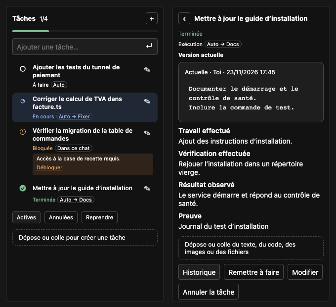

# Session Tasks

  

Local Codex Desktop plugin. Node.js 22.18+, TypeScript, SQLite, native MCP App.

The chat and panel share a persistent task queue. The panel displays the current instruction, with previous instructions and attachments in a separate history. A user edit invalidates the claim on the previous revision. Cancellation keeps the revision history and removes the item from the active queue.

Completion requires the agent to report the work performed, an executed check, the observed result and evidence. If a check fails or cannot run, the agent records a blocker. The task details display those fields. Click the checkmark or **Mark as to do** to queue the same task for another attempt.

Use **Validate** and enter what you checked and observed. You can validate a queued or blocked task yourself, or add a human check to a task Codex completed while keeping its original evidence. **Unblock** lets you respond to a blocker and confirm that Codex can resume. The task returns to the queue, and both the previous blocker and your approval stay in the discussion. If Codex is idle, the panel asks it to resume. Task rows show relative creation and completion times. The detail shows exact dates, and legacy completion estimates are marked as such.

The task detail keeps **Close** and **Post** at the bottom as you scroll. Drop files or images into the comment form, or paste them from the clipboard. Preview and remove attachments before posting. Published attachments belong to the comment. Posting keeps the task open. User comments are polished in the background. A successful reformulation replaces the saved text. If reformulation fails, the submitted text stays available. Task details, revision history, verification notes, and comments display Markdown.

Click Markdown links or pasted web addresses in read-only text, including comments, instructions, verification notes and original text. Session Tasks delegates to the host when supported. Links keep their original destinations after reformatting.

Use **Remaining**, **Blocked**, and **Done** independently to combine filters. **Reorder** opens the remaining tasks and focuses the first usable grip. Hover over a queued task or focus its grip with the keyboard to show **Move up** and **Move down**. The buttons stay visible on touch devices. You can also drag the grip or press ↑ or ↓ while it has focus. The arrow at the end of the action bar goes to the last page. The board opens there and jumps down when Codex adds a task while the task list is visible.

Open **Instructions** to add or edit Markdown instructions. Type in the footer and press **Enter** to save to this chat, or use **+** to choose **This chat**, **Selected projects**, **All projects except…**, or **Everywhere**. Use **Select all** or **Deselect all** above the project list, then adjust individual checkboxes before saving. You can select up to 100 project IDs per save. The two project scopes skip chats without a project. **All projects except…** includes future projects automatically. **Everywhere** includes chats with or without a project. Changes apply after saving. The local Codex project registry is read-only, and overlapping bindings apply the shared instruction once.

In **When to apply**, select one or more moments. **Each turn** is the default for new and existing instructions. **At session start** uses Codex's trusted `SessionStart` hook when the session starts or resumes. **At the end of the turn** uses the trusted `Stop` hook to give Codex one opportunity to apply the instruction before ending a turn. Closing the chat does not trigger an extra model run.

**Detach** removes one binding. **History** lists instructions newest first, including instructions with no bindings. Unassigned instructions have a **Delete** action directly in History and in their detail. Deletion requires confirmation. **Attach** adds bindings to an existing instruction. Use **Edit** to replace existing assignments with **All projects except…**. New and edited instructions are reformulated in the background. Codex applies the original text. You can paste text or drop UTF-8 text or Markdown files in the instruction editor. You can also ask Codex in chat to create an instruction and name the projects to include or exclude. Codex resolves the project names and reports the saved destinations.

## Quick actions

Use **Actions** to save a reusable prompt. Enter the text, choose its scope and optionally set a title and a palette or hex color. Saving closes the editor. Codex then generates a title and formats the text into paragraphs while preserving the executable wording. If no color is set, Codex can choose one of the 15 palette colors. If optimization fails, the saved text is used. The default makes the action available across chats. You can restrict it to this chat or to selected projects. Use the arrows in the library to change the order. The shortcuts stay available in every tab, in a two-column grid near the bottom of narrow panels. The grid shows up to three rows and scrolls vertically when more actions are available. Short panels leave one or two rows visible.

Clicking a shortcut sends it to the chat that owns the open panel. The message contains only the saved action text. Session Tasks verifies the exact text and the click’s receipt, carried separately in the app context, before applying it. You can also ask Codex to create an action without running it.

## Host integration

The plugin registers **Session Tasks** in the chat's side-panel tab picker. Choose it to open the current chat's board without sending a message. Open the existing tab when it is already present. Codex works with the board's tools without opening panel tabs during task processing. The local Codex plugin accepts the current chat identifier from the desktop host over its private stdio connection. The **Sources** list remains part of the Codex summary.

The **Notes** tab keeps one editable Markdown note per chat. Click the note or the pencil to edit it. User edits are saved immediately and polished with Codex in the background. If polishing fails, the saved text stays available. Codex can also append useful context directly, and its wording is stored as written. Notes do not wake the chat or post a message. The trash icon opens a deletion confirmation. The task icon opens the ordinary task editor with the note, or with the selection in edit mode. The task is created when you save that form.

## Install from the source checkout

1. Run `npm ci` and `npm run package` in the plugin checkout.
2. Use `codex plugin marketplace add ./artifacts/marketplace` and `codex plugin add session-tasks@session-tasks-local`. Review the bundled hook definitions in the host and approve the ones you want to run. Keep the checkout and its Node runtime available to Codex.
3. Open a chat, then select **Session Tasks** from the side-panel tab picker. When you submit a work request, the `UserPromptSubmit` hook supplies the same board to Codex.

For HTTP clients or the integration verifier, you can also run `node <checkout>/dist/http-server.mjs 46173` using Localhost Supervisor. HTTP callers must provide a board capability to open the panel.

During a turn, add entries directly in the panel. Codex rereads the queue between tasks. The Stop hook asks Codex to check for pending work and unread updates before ending the turn. If the board changes during that check, the hook can ask again, up to three checks per turn. When the first new task is added to a drained board after the local chat's last turn has ended, the panel asks Codex to resume that chat with a short prompt. **Resume** is available when the host supports messages and the automatic wake could not be confirmed. **Release claim** lets you return an abandoned item to the queue after checking the previous worker has stopped. The old claim becomes invalid immediately. **Cancel task** is reversible from the Cancelled list.

Each panel resume request includes a one-time code for that chat. The generic MCP message envelope leaves the code available for the actual Session Tasks message. Codes expire after 30 seconds.

Each quick action click sends a separate message, tied to the chat and the saved action revision. Clicks remain valid while messages wait for Codex. Editing or removing an action invalidates its earlier pending clicks.

Posting a user comment from the panel notifies its owning chat. The first unread comment can wake an idle chat. Later comments are grouped with it. During a turn, Codex checks for comments between tasks and before ending. If the automatic wake was unavailable, use **Resume**. Codex reads the comment on its task and acknowledges it after review. The notification persists until acknowledged and carries no comment text in the chat message.

**Resume** also checks for unread edits made in the task panel. Codex compares the revisions, acts when the update calls for action, and records receipt inside Session Tasks. Informational updates stay on their tasks.

The service listens on IPv4 loopback only. It checks Host and Origin and returns task data only for the current board capability. Task files stay in the local SQLite database under `~/Library/Application Support/Session Tasks/` until they are fetched for the intended work. An individual attachment can be at most 4 MiB, with at most 8 files per task revision and 8 MiB of new attachments per save. Keep the installation directory available to the supervisor.

Run `npm run check` for formatting, type and SQLite tests and `npm run verify-mcp` against the running service for the real MCP and hook flow.

Run `npm run verify-live-add` for the live continuation check. It starts a disposable Codex turn, waits for a claimed task, adds a second task through the panel's MCP tool and verifies that both end in the same turn. It uses the installed plugin and trusted hooks. Set `SESSION_TASKS_CODEX_CLI` to the matching Desktop CLI if multiple Codex versions are installed.

The experimental native summary companion is separate from the MCP plugin package. Its version-guarded script stages a copy of Codex, inserts the read-only task list immediately after Sources, verifies the archive and signs the staged copy. Installation requires a compatible signing team for its linked libraries and a clean shutdown. The exchange is atomic and leaves the prior bundle in the staging directory for restoration.

In the panel, drop a file, image or plain text anywhere on the list to create a queued task and open its editor with the title field empty. Open a task's details before dropping a file to attach it there. Pasting on a focused row attaches to that task. Pasting on the panel background creates a task. Text pasted into an input keeps its normal behavior. The list scrolls independently of the add and filter controls.

When you create or edit a task without a title, the first non-empty line of the details or the first attachment's filename gives the task a provisional title. The editor closes after saving, and **Reformulating task…** appears while GPT-6.1 Terra generates a title and a Markdown description with Low reasoning at standard speed. The original input stays available immediately, including if generation is unavailable.

Use the small **+** to open the full editor, or type a title in the list and press **Enter** to add it immediately. Enter a title, details, or both. The panel saves immediately and uses Codex to suggest both a title and a Markdown description in the background. Open **Original text** in the task to see the saved input. The editor and Codex execution use those original instructions. Click a task title to see its instructions, verification evidence, attachments and expandable revision history. Click the pencil to edit it directly. After successful validation, the panel returns to the list unless you have an unfinished comment. The version is shown below the filters. Codex controls the width of the native tab; the panel layout adapts when you resize it.

The quick-add field, full editor button, and completion progress stay at the bottom while the task list scrolls. Press **Command+Enter** or **Ctrl+Enter** anywhere in an open task editor to save. The same shortcut submits the confirmation form when it is open with a verification observation.

Session Tasks remembers the selected tab, task filters and current list position separately for each chat. Reopening or refreshing the panel restores that view.

Quick actions stay at the bottom of every tab. The grid fits up to two, three or four actions per row, according to the panel width, and scrolls vertically when more rows are available.
Clicking a quick action sends its saved text to the chat. When tasks or updates are waiting, **Resume** appears beside the task filters with a play icon and its own accent.
